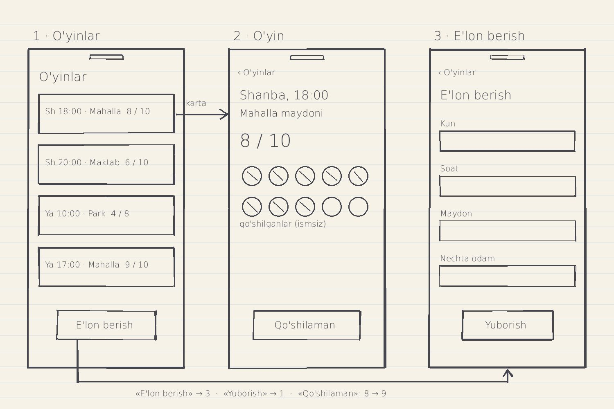

# maydon-jamoa

«Maydon Jamoa» — mahalladagi mini-futbol uchun jamoa yig'adigan mahsulot: tashkilotchi o'yin e'lon qiladi
(kun, soat, maydon, nechta odam kerak), boshqa o'yinchilar «Qo'shilaman» ni bosadi; e'londa «8 / 10» — qo'shilganlar / kerak.

Bu repo — 11, 12 va 13-Modul Mentor misoli: prototip, ilova va Backend'ni 11-Modulda qurasiz, 12-Modulda — lending, real vaqt, eslatma va birinchi foydalanuvchilar, 13-Modulda — pul: Pro va test rejimdagi to'lov.

## Talab (7-dars)

Prototip agentga shu talab va `wireframe.jpg` surati bilan qurildi:

> **Qayerda:** `prototip/` papkasi — yangi React + Vite loyihasi; `README.md`.
> **Nima qilsin:** `wireframe.jpg` dagi ekranlar — O'yinlar: o'yin kartalari, har birida kun, soat, maydon, «8 / 10», pastda «E'lon berish»; O'yin: «‹ O'yinlar», kun, soat, maydon, «8 / 10», qo'shilganlar (10 ta joy, ismsiz doiralar), «Qo'shilaman»;
> E'lon berish: kun, soat, maydon, nechta odam, «Yuborish». Ma'lumot `prototip/src/namuna.js` da: 4 ta o'yin, Shanba va Yakshanba.
> Ekranlar bir-biriga bosib o'tilsin: karta → O'yin, «E'lon berish» → E'lon berish, «Yuborish» → O'yinlar; «Qo'shilaman» sonni bittaga oshirsin. `README.md` ga shu talabni va `wireframe.jpg` suratini qo'sh.
> **Nima buzilmasin:** haqiqiy ma'lumot va Backend yo'q — hammasi faqat ochiq sahifada. `prototip/` va `README.md` dan tashqariga tegma, o'zgargan fayllarni ayt.



Bu prototip ma'lumotni saqlamaydi: ma'lumot `prototip/src/namuna.js` da, Backend yo'q — sahifa yangilansa, yana «8 / 10».

## Arxitektura

Uch qism: ilova ko'rsatadi, Backend tekshiradi, Database saqlaydi.

```
ilova (Expo) → Backend (NestJS) → Database (Neon)
   so'rov →        tekshiradi →      saqlaydi
   ← javob
```

Asosiy funksiyalar (PRD): o'yin e'loni va qo'shilish · o'yin kuni tasdiq · chiqish va navbat.
Saqlanadigan ma'lumotlar: o'yinchilar · o'yinlar · kim qaysi o'yinga qo'shilgani.

### Jadvallar

**`oyinchilar`** — ro'yxatdan o'tgan odamlar

| Ustun | Nima saqlaydi |
|---|---|
| `id` | o'yinchi raqami (Database o'zi to'ldiradi) |
| `ism` | ismi |
| `login` | kirish uchun o'zi tanlagan nom (3–20 belgi, harf va raqam; kichik harfda; takrorlanmaydi) — boshqa o'yinchilar ko'rmaydi. 12-Modul 7-darsgacha bu yerda `telefon` edi |
| `parol_hash` | hash — paroldan yasalgan satr: undan parolni qaytarib bo'lmaydi (parolning o'zi saqlanmaydi) |
| `namuna` | `true` — namuna va tekshiruv akkauntlari (sanoqqa kirmaydi); ro'yxatdan o'tish formasi har doim `false` yozadi |
| `telegram_chat_id` | Telegram chat raqami (13-Modul 8-dars) — faqat xabar yuborish uchun; botda «Start» bosilganda yoziladi, «Telegram xabarlarini o'chirish»da o'chadi; ilovaga yuborilmaydi |
| `telegram_kod` · `telegram_kod_gacha` | bir martalik kod (16 harf-raqam) va muddati (10 daqiqa) — `t.me/<bot>?start=<kod>`; ishlatilgach o'chadi |
| `taklif_kodi` | taklif kodi (13-Modul 10-dars) — 6 belgi, katta harf va raqam, noyob; yangi hisobga ro'yxatdan o'tishda, mavjudlarga bir marta (Backend ishga tushganda) |
| `pro_gacha` | Pro muddati (13-Modul 4-dars) — shu vaqtgacha Pro; bo'sh — Pro yo'q. Muddat tugagach Pro o'zi to'xtaydi, avtomatik to'lov yo'q |
| `yaratilgan` | ro'yxatdan o'tgan vaqt (Database o'zi to'ldiradi) |

**`oyinlar`** — e'lon qilingan o'yinlar

| Ustun | Nima saqlaydi |
|---|---|
| `id` | o'yin raqami (Database o'zi to'ldiradi) |
| `kun` | o'yin kuni — sana, masalan `2026-10-10` |
| `soat` | boshlanish soati, masalan `18:00` |
| `maydon` | maydon nomi, masalan «Mahalla maydoni» |
| `kerak` | nechta odam kerak — «8 / 10» dagi 10 |
| `tashkilotchi_id` | o'yinni kim e'lon qilgani → `oyinchilar.id`; tashkilotchi hisobini o'chirsa — bo'sh (`null`), o'yin qoladi |
| `doimiy` | «Doimiy o'yin» (13-Modul 4-dars, Pro): `true` — seriyaning eng oxirgi o'yini; vaqti o'tgach `GET /oyinlar` da keyingi haftaning o'yini yaratiladi va belgi unga o'tadi |
| `yaratilgan` | e'lon qachon berilgani (Database o'zi to'ldiradi) |

**`ishtirokchilar`** — kim qaysi o'yinda; har qo'shilish — bitta qator

| Ustun | Nima saqlaydi |
|---|---|
| `oyin_id` | qaysi o'yin → `oyinlar.id` |
| `oyinchi_id` | qaysi o'yinchi → `oyinchilar.id` |
| `holat` | `qoshildi` · `keladi` (o'yin kuni «Kelaman» bosgan) · `navbatda` · `chiqdi` |
| `yaratilgan` | qator qachon yozilgani — navbat tartibi shundan (Database o'zi to'ldiradi) |

**`hodisalar`** — qadamlar sanog'i (12-Modul 7-dars): har yozuv — bitta qurilmadagi bitta qadam; ism, login va token yozilmaydi; 60 kundan eskilari o'chiriladi

| Ustun | Nima saqlaydi |
|---|---|
| `id` | yozuv raqami (Database o'zi to'ldiradi) |
| `nom` | qadam: `ochdi` · `royxatdan-otdi` · `qoshildi` · `tasdiqladi`; sanoq yozuvlari `eslatmadan-ochdi` (9-dars) · `telegramdan-ochdi` (13-Modul 8-dars) |
| `qurilma_id` | qurilma ID — ilova birinchi ochilganda yaratgan tasodifiy harf va raqamlar: odamning ismini ham, loginini ham bildirmaydi |
| `yaratilgan` | yozuv vaqti (Database o'zi to'ldiradi) |

**`tolovlar`** — to'lov xabarlari (13-Modul 3-dars): har to'lov raqami — bitta qator; test rejim — pul yechilmaydi, karta ma'lumoti yo'q

| Ustun | Nima saqlaydi |
|---|---|
| `id` | yozuv raqami (Database o'zi to'ldiradi) |
| `tolov_raqami` | to'lov raqami (mashqda `m-…`) — noyob: bitta raqam jadvalda bir marta (takror xabar ikkinchi qator yozdirmaydi) |
| `oyinchi_id` | kim to'lagani → `oyinchilar.id`; hisob o'chirilsa — uning to'lov yozuvlari ham o'chadi |
| `summa` | so'mda, butun son |
| `holat` | `tolandi` · `rad` (rad etilgan to'lov ham yoziladi) |
| `yaratilgan` | xabar qachon yozilgani (Database o'zi to'ldiradi) |

**`boshlangan_tolovlar`** — «To'lovga o'tish» bosilganda Backend bergan to'lov raqamlari (13-Modul 4-dars); mashq sahifasi va to'lov xabari hisob va summani shundan oladi

| Ustun | Nima saqlaydi |
|---|---|
| `id` | yozuv raqami |
| `tolov_raqami` | `m-` va 12 ta tasodifiy harf-raqam — noyob |
| `oyinchi_id` | to'lovni boshlagan tashkilotchi → `oyinchilar.id` |
| `summa` | so'mda (`PRO_NARX`) |
| `yaratilgan` | qachon boshlangan |

**`telegram_yangilanishlar`** — ishlangan Telegram so'rovlari (`update_id`, `yaratilgan`; 8-dars): Telegram javob olmasa so'rovni qayta yuboradi —
bir xil `update_id` ikkinchi marta ishlanmaydi. Xabar matni, ism va Telegram nomi yozilmaydi.

Bog'lovchi ustunlar — boshqa jadvaldagi qatorni ko'rsatadigan ustun: `oyinlar.tashkilotchi_id` → `oyinchilar` ·
`ishtirokchilar.oyin_id` → `oyinlar` · `ishtirokchilar.oyinchi_id` → `oyinchilar`.

| Funksiya | Qaysi jadvalga nima yozadi |
|---|---|
| O'yin e'loni va qo'shilish | e'lon — `oyinlar` ga qator (`tashkilotchi_id` — e'lon bergan); «Qo'shilaman» — `ishtirokchilar` ga qator, `holat` = `qoshildi` |
| O'yin kuni tasdiq | «Kelaman» — `ishtirokchilar` dagi o'sha qatorda `holat` = `keladi` |
| Chiqish va navbat | to'lgan o'yinga — `ishtirokchilar` ga qator, `holat` = `navbatda`; chiqqanda — `holat` = `chiqdi`, navbatdagi birinchi qator — `qoshildi` |

«8 / 10»: 8 — shu o'yinning `ishtirokchilar` dagi `qoshildi` yoki `keladi` qatorlari soni (`navbatda`, `chiqdi` sanalmaydi), 10 — `oyinlar.kerak`.

### Real vaqt nuqtalari

Real vaqt nuqtasi — ekran ochiq turganda boshqa odam tufayli ma'lumoti o'zgarishi mumkin bo'lgan joy.

| Joy | Ilova qachon so'raydi |
|---|---|
| «8 / 10» | ekran ochilganda va pastga tortib yangilaganda |
| qo'shilganlar ro'yxati | ekran ochilganda va pastga tortib yangilaganda |
| o'yin kunidagi «Kelaman» belgilari | ekran ochilganda va pastga tortib yangilaganda |

11-Modulda ekran o'zi yangilanmasdi (WebSocket — roadmap'da «keyinroq»); 12-Modulda — doimiy ulanish, pastga tortib yangilash qoladi: «Real vaqt» bo'limi.

### Platforma

**Mobil** — o'yinchi maydonda, qo'lida telefon; eslatma telefonga kelishi kerak.

### Stek

| Qism | Texnologiya |
|---|---|
| ilova | Expo (React Native), telefonda Expo Go orqali |
| Backend | NestJS va TypeORM, Render |
| real vaqt | socket.io — doimiy ulanish (imkon bo'lsa WebSocket orqali): Backend'da NestJS gateway (`@nestjs/websockets`, `@nestjs/platform-socket.io`), ilovada `socket.io-client` |
| eslatma | `expo-notifications` — rejalashtirilgan eslatma (ilova o'zi oldindan qo'yadi; Expo Go'da ham ishlaydi) |
| Database | Neon (PostgreSQL) |

## Real vaqt

| Real vaqt nuqtasi | Kim nima qiladi | Hodisa | Kim oladi | Ekranda nima o'zgaradi |
|---|---|---|---|---|
| «8 / 10» va qo'shilganlar ro'yxati | o'yinchi «Qo'shilaman» ni bosadi | `oyin-ozgardi` · sabab `qoshildi` | hamma ulangan ilova | «8 / 10» → «9 / 10», ro'yxatda yangi o'yinchi |
| «8 / 10» va qo'shilganlar ro'yxati | o'yinchi o'yindan chiqadi (navbatdagi kirsa — shu hodisa) | `oyin-ozgardi` · sabab `chiqdi` | hamma ulangan ilova | son va ro'yxat yangilanadi |
| «Kelaman» belgilari | o'yinchi «Kelaman» ni bosadi | `oyin-ozgardi` · sabab `tasdiqladi` | hamma ulangan ilova | «Kelishini tasdiqladi: 7 / 9» → «8 / 9» |
| «Navbatda: N» | o'yinchi navbatga yoziladi | `oyin-ozgardi` · sabab `navbatga-yozildi` | hamma ulangan ilova | «Navbatda: 1» |
| o'yinlar ro'yxati | tashkilotchi o'yin e'lon qiladi | `oyin-ozgardi` · sabab `elon-berildi` | hamma ulangan ilova | ro'yxatda yangi karta |

`oyin-ozgardi` — `{ oyinId, sabab }`. Hodisa o'zgarish bo'lganini aytadi; yangi holatni ilova Backend'dan qayta so'raydi.
Backend hodisani o'zgarish Database'ga yozib tugatilgandan keyin yuboradi (tranzaksiya bo'lsa — u tugagach); ilova bitta hodisadan keyin `GET /oyinlar` ni bir marta so'raydi — «O'yinlar» va «O'yin» shu javobdan o'qiydi.

### Ulanish holatlari

- Ulangan — belgi «Ulangan», o'zgarishlar o'zi ko'rinadi.
- Ulanmoqda — belgi «Ulanmoqda…», ro'yxat ekranda qoladi (eskirgan bo'lishi mumkin).
- Ulanmagan — belgi «Ulanmagan», pastga tortib yangilash ishlaydi.

### Chekka holatlar

1) Internet uzilib qaytsa — ro'yxat yangi holatni ko'rsatsin.
2) Bitta o'zgarish ekranni bir marta yangilasin — ulanish qayta tiklangandan keyin ham.
3) Ilova boshqa ekranda yoki fonda turganda o'zgarish bo'lsa — «O'yinlar»ga qaytganda yangi holat ko'rinsin.

Chekka holatlar 5-darsda uch usul bilan buzib tekshirildi (internetni uzish · fonga olib qaytarish · Backend'ning yangi versiyasi) — yozuv `BUZISH.md` da.
Topilgan uch muammo tuzatilgan: qayta ulanganda ro'yxat qayta so'raladi · `oyin-ozgardi` tinglovchisi bir marta (`connect` dan tashqarida) · qayta ulanganda ilova ochiq o'yin xonasiga qayta kiradi.

### Xona, «Hozir ko'ryapti», jonli xabar va eslatma

| Hodisa | Kim yuboradi → kim oladi | Ma'lumot |
|---|---|---|
| `oyin-ozgardi` | Backend → hamma ulangan ilova | `{ oyinId, sabab }` |
| `oyin-ochildi` · `oyin-yopildi` | ilova («O'yin» ekrani ochildi / yopildi) → Backend | `{ oyinId }` |
| `korayotganlar-ozgardi` | Backend → xona `oyin-{id}` | `{ oyinId, soni }` |

- **Xona** — Backend'dagi ulanishlar guruhi: hodisa faqat shu guruhdagilarga boradi; har o'yinning o'z xonasi `oyin-{id}`.
  **«Hozir ko'ryapti: N»** — «O'yin» ekranini hozir ochib turgan ulanishlar (o'zingiz ham sanalasiz; ism yo'q). Bu son Database'da yo'q — shuning uchun hodisa sonning o'zini olib keladi.
- **Jonli xabar** — ilova ochiq turganda ekran tepasida bir necha soniya: faqat o'zingizga tegishli o'yin uchun (qo'shilgan, navbatda yoki o'zingiz e'lon qilgan), o'z harakatingiz uchun emas, ismsiz.
  Qaysi xabar — hodisadan keyingi `GET /oyinlar` javobi oldingisi bilan solishtirib: «Shanba, 18:00 — yana bir o'yinchi qo'shildi: 9 / 10» · «… — o'yin to'ldi: 10 / 10» · «… — joy bo'shadi: 8 / 10» ·
  «… — kelishini tasdiqladi: 8 / 9» (faqat tashkilotchiga) · «Navbatdan o'yinga o'tdingiz: Shanba, 18:00».
- **Eslatma** — rejalashtirilgan: «Qo'shilaman» bosilganda ilova o'yindan bir soat oldinga qo'yadi («Maydon Jamoa» · «Bugun, 18:00 · Mahalla maydoni»), bir soatdan kam qolgan bo'lsa — qo'yilmaydi;
  «O'yindan chiqish» — bekor. Faqat shu telefonda: boshqa telefondan kirilsa — u yerda eslatma yo'q; telefonda eslatmalar o'chirilgan bo'lsa — chiqmaydi.
  Yopiq ilovada boshqa odamning o'zgarishi («joy bo'shadi») ko'rinmaydi. Backend yuboradigan eslatma (push notification) — qurilmagan: Google yoki Apple xizmati va alohida sozlash kerak, Expo Go'da ishlamaydi.
- **«N joy qoldi»** (9-dars) — o'zingiz qo'shilmagan o'yinda bir yoki ikki joy qolganda: «Shanba, 18:00 — 2 joy qoldi» (yangi hodisa yo'q — son qayta so'ralgan javobdan; ilova ochiq davrda bir o'yinda bir xil son uchun bir marta).
- **Uch kunlik eslatma** (9-dars, `mobil/src/eslatma.ts`) — ilova har ochilganda oldingisi bekor, yangisi uch kundan keyin 17:00 ga: «Hafta oxiriga o'yin bormi? E'lonlarni ko'ring» —
  ilovani uch kun ochmagan odamga chiqadi (yopiq ilova yangi e'lonni bilmaydi — matn taklif qiladi); faqat hisobga kirgan foydalanuvchiga, «Hisobdan chiqish»da bekor.
  Haftalik chegara: o'sha haftada (dushanbadan yakshanbagacha) ilovaning ikkita eslatmasi bo'lsa (o'yin eslatmasi ham sanaladi) — qo'yilmaydi; qo'yilgan eslatmalar vaqti telefonda saqlanadi.
  Haftalik chegara kodda bor, telefonda tekshirilmagan (bir hafta kerak).
- **Eslatma sanog'i va o'chirgich** (9-dars) — ilovaning istalgan eslatmasi bosilib ilova ochilsa (fonda ham, butunlay yopiq bo'lsa ham) — sanoq yozuvi `eslatmadan-ochdi`
  (bitta bosishga bitta; bitta ochilish ikki yozuv beradi: `ochdi` va `eslatmadan-ochdi`). Sanoq sahifasida qadamlar ostida — «eslatmadan ochdi» (turli qurilmalar):
  bu son eslatma bosilganini aytadi, eslatmasiz ham ocharmidi — buni aytmaydi. «O'yinlar» tepasida «Eslatmalar» o'chirgichi (sukutda yoqiq, tanlov telefonda):
  o'chirilsa — hamma rejalashtirilgan eslatma bekor; yoqilsa — qo'shilgan, hali boshlanmagan o'yinlar va uch kunlik eslatma qaytadan.
  Telefonda ruxsat berilmagan bo'lsa — ostida «Telefon sozlamalarida eslatmalarga ruxsat berilmagan».

### Havolani ulashish (10-dars — Mentor zaxira rejasidagi ish)

Zaxira reja: bo'g'in — kanal (post faqat ikki joyga yetdi: 60 kishilik guruh va sinf chati); gipoteza — «Agar har o'yin e'loni bilan birga havola yuborilsa,
yangi odamlar keladi, chunki tashkilotchi o'z jamoasini o'zi chaqiradi»; ish — e'lon berilgach ilovada «Havolani ulashish» tugmasi (7-dars rejasining 3-bosqichi oldinga suriladi).
«O'yin» ekranida, o'yinni e'lon qilgan tashkilotchida: telefonning ulashish oynasi ochiladi — tashkilotchi o'zi tanlagan joyga yuboradi (ilova hech kimga o'zi yubormaydi).
Havola — lending manzili `?kanal=ilova` belgisi bilan (`mobil/src/lending.ts`): Umami'da `tashrif` hodisasi kanal bo'yicha ko'rinadi — gipoteza shu bilan tekshiriladi.
APK o'zi yangilanmaydi: tugma odamlarga yangi o'rnatish fayli va lendingdagi yangi havola bilan yetadi.

## To'lov (13-Modul)

Test rejim: pul yechilmaydi. Karta ma'lumoti hech qayerda so'ralmaydi va yozilmaydi; maxfiy kalit (`TOLOV_KALITI`) — faqat `backend/.env` va Render'da.

### Reja: to'lov oqimi

| Kim | Nima qiladi | Kimga |
|---|---|---|
| Ilova | «To'lovga o'tish» bosilganda to'lov sahifasini ochadi | Brauzer |
| Tashkilotchi | to'lov sahifasida to'laydi yoki rad etadi; karta ma'lumoti faqat xizmatda | To'lov xizmati |
| To'lov xizmati | to'lov xabarini yuboradi: POST /tolov/webhook | Backend |
| Backend | imzoni tekshiradi, to'lovni bir marta yozadi, Pro muddatini uzaytiradi, 200 qaytaradi | To'lov xizmati |
| Ilova | Pro holatini qayta so'raydi: GET /men | Backend |

Hozircha: «To'lovga o'tish» Backend'dan to'lov raqamini oladi va mashq to'lov sahifasini ochadi; «To'lash (mashq)» dan keyin to'lov xabari Pro'ni 30 kunga uzaytiradi, ilova uni `GET /men` dan o'qiydi. Test rejim: pul yechilmaydi.

5-darsda to'rt usul bilan buzib tekshirildi (ikki marta yuborish · kechiktirib yuborish · rad etish · noto'g'ri imzo) — yozuv `BUZISH.md` «To'lov» da.
Topilgan ikki muammo tuzatilgan: Pro faqat yangi yozilgan to'lovdan keyin uzayadi (yozuv va Pro bitta tranzaksiyada) · javob kelmasa sahifa «Javob kutilmoqda» deydi,
ilovada «Qayta tekshirish» — qaytganda va tugma bosilganda `GET /men` qayta so'raladi.

### Pro va «Doimiy o'yin» (4-dars)

Pul modeli — bepul asos va pullik qo'shimcha: o'yinchilar uchun hamma narsa bepul; tashkilotchi uchun **Pro** (30 kunlik pullik obuna) —
bitta qulaylik: **«Doimiy o'yin»** — har hafta shu kun va soatda o'yin o'zi e'lon qilinadi. Narx — Mentorning taxmini: 30 kun — 15 000 so'm.

- «E'lon berish» ekranida belgi **«Har hafta takrorlansin»**: Pro bo'lmasa — to'lov taklifi ekrani (`mobil/src/app/pro.tsx`): «Doimiy o'yin — Pro'da» ·
  «Har hafta shu kun va soatda o'yin o'zi e'lon qilinadi.» · «30 kun — 15 000 so'm» · «To'lovga o'tish» · pastda kulrang «Test rejim: pul yechilmaydi»; karta maydoni yo'q,
  orqaga qaytsa belgi o'chiq qoladi. Pro bo'lsa — belgi yonadi, ostida kulrang «Pro: 6-noyabrgacha». Pro holati — `GET /men` dan (ilova ochilganda va «E'lon berish» ochilganda).
- `POST /oyinlar` `doimiy: true` ni faqat Pro'dagi tashkilotchidan qabul qiladi (aks holda `403`, o'yin yaratilmaydi).
- Keyingi o'yin **`GET /oyinlar` so'ralganda** yaratiladi (`backend/src/doimiy.ts`): doimiy o'yinning vaqti o'tgan bo'lsa (Toshkent vaqti) — bir haftadan keyingi kunga,
  o'sha soat, maydon, kerakli odamlar soni va tashkilotchi bilan; `doimiy` belgisi yangisiga o'tadi. Backend uxlashi mumkin — vaqtga bog'langan ish (taymer) yo'q.
- Pro muddati tugagach Pro o'zi to'xtaydi (`GET /men` da `pro: false`) — avtomatik to'lov yo'q. 5-darsdan: «Har hafta takrorlansin» yana to'lov taklifi ekranini ochadi,
  keyingi «Doimiy o'yin» faqat tashkilotchining Pro muddati ichida yaratiladi — Pro tugasa yangi o'yin o'zi e'lon qilinmaydi, e'lon qilingan o'yinlar qoladi.
- **To'lov yo'li:** «To'lovga o'tish» → `POST /tolov/boshlash` (token bilan): Backend yangi to'lov raqamini yaratadi — `m-` va 12 ta tasodifiy harf-raqam
  (ketma-ket emas: raqam manzilda turadi), `boshlangan_tolovlar` ga hisob va summa bilan yozadi → `{ tolovRaqami, havola }` → ilova havolani telefon brauzerida ochadi
  (brauzer ko'rinishida — yangi oynada) → «Mashq to'lov» sahifasi → «To'lash (mashq)» → to'lov xabari → `pro_gacha` 30 kunga uzayadi
  (Pro bo'lmasa hozirdan, bo'lsa muddat oxiridan) → ilovaga qaytganda `GET /men`.
  To'lovdan qaytgandagi holatlar (5-dars; `GET /men` dagi `oxirgiTolov`): `tolandi` — Pro · `rad` — «To'lov o'tmadi — qayta urinib ko'ring» va «To'lovga o'tish» ·
  `kutilmoqda` (to'lov xabari hali kelmagan) — «Javob kutilmoqda». Narx va muddat — Backend'da bitta joyda: `backend/src/tolov/narx.ts` (`PRO_NARX = 15000`, `PRO_KUN = 30`).

Tekshiruv uchun (faqat o'z hisobingiz, `WHERE id` bilan): `UPDATE oyinchilar SET pro_gacha = now() + interval '1 day' WHERE id = {hisob raqami};` ·
tekshiruv o'yinini o'tgan haftaga: `UPDATE oyinlar SET kun = kun - 7 WHERE id = {o'yin raqami};` → ro'yxatni yangilang — keyingi haftaning o'yini chiqadi ·
tozalash: `UPDATE oyinchilar SET pro_gacha = NULL WHERE id = {hisob raqami};`, `DELETE FROM oyinlar WHERE id IN ({tekshiruv o'yinlari});`.

**To'lov xabari** (webhook) — `POST /tolov/webhook`, tana `{ tolovRaqami, holat: 'tolandi' | 'rad', summa, oyinchiId }` (`summa` — so'mda),
sarlavha `X-Imzo` = HMAC SHA-256 (so'rovning xom tanasi, `TOLOV_KALITI`), hex. Tartib: imzo → maydonlar → takror → yozuv:
imzo yo'q, shakli noto'g'ri yoki mos emas — `401`, hech narsa yozilmaydi · maydon yetishmasa yoki `holat` boshqa — `400` ·
shu to'lov raqami jadvalda bor — `200 { takror: true }` (bir vaqtda kelgan ikkinchi bir xil xabar ham) · yangi — `200 { ok: true }`, `rad` ham yoziladi.

**«Mashq to'lov» sahifasi** — Backend'ning o'zi beradi: `{Backend manzili}/tolov-mashq?raqam={to'lov raqami}` (4-darsdan; 3-darsda — `?oyinchi=…&summa=…`).
Raqam `POST /tolov/boshlash` dan; raqamsiz yoki noma'lum raqam bilan — «To'lov topilmadi.», tugmalar yo'q. Hisob va summa raqamdan olinadi; to'rt tugma shu raqam bilan ishlaydi. Sarlavha «Mashq to'lov», «Bu sahifa — mashq. Karta so'ralmaydi, pul yechilmaydi.»,
«Maydon Jamoa — Pro, 30 kun» va summa; tugmalar «To'lash (mashq)» · «Rad etish (mashq)» va tekshiruv tugmalari «Ikki marta yuborish» · «Imzosiz yuborish».
Tugma bosilganda sahifa `POST /tolov-mashq/yubor { tur, raqam }` ga yozadi; Backend xabarni bitta JSON satr qilib yasaydi,
aynan shu satrni imzolaydi va o'zining ochiq manzilidagi `POST /tolov/webhook` ga yuboradi (Render'da `RENDER_EXTERNAL_URL`, laptopda `localhost:PORT`) —
kalit brauzerga chiqmaydi. Sahifada har yuborishning javobi: holat kodi va tanasi; «To'lash (mashq)» dan keyin — «To'lov o'tdi (mashq) — ilovaga qayting.», rad — «To'lov o'tmadi.».
Bitta raqam — bitta natija: shu raqam bilan keyingi xabar (rad etilgandan keyingi «To'lash» ham) — takror; qayta to'lash — ilovada yana «To'lovga o'tish» (yangi raqam).
Sahifa ostida: «Real ishga tushirish — ota-onaning yozma roziligi va yuridik shaxs yoki YaTT (yakka tartibdagi tadbirkor) bilan; bu kursda emas.»
5-darsdan yana ikki tugma: «Kechiktirib yuborish» — xabar 70 soniya kutib yuboriladi (uxlagan Backend o'rnida; haqiqiy bepul Backend 15 daqiqa so'rovsiz qolsa uxlaydi) ·
«Noto'g'ri imzo» — xabar `TOLOV_KALITI` bilan emas, boshqa (maxfiy bo'lmagan) kalit bilan imzolanadi → `401`.
Uch tekshiruv: «Imzosiz yuborish» → `401`, yangi qator yo'q · «Ikki marta yuborish» → `200 { ok: true }` va `200 { takror: true }`, `tolovlar` da bitta qator · «Rad etish (mashq)» → `200`, qator `rad`.

```sql
SELECT tolov_raqami, holat FROM tolovlar ORDER BY yaratilgan DESC;
```

`tolovlar` dagi qatorlar — mashq (`m-…`): real to'lov yo'q, sanoqqa kirmaydi.

## Telegram xabari (13-Modul 8-dars)

Ilova o'zi oldindan qo'ygan eslatma ilova yopiq paytda yangi e'lon bor-yo'qligini bilmaydi (12-Modul); Backend biladigan haqiqiy o'zgarish haqida — **Telegram bot** orqali.
Bot — **yangi bot** (@BotFather: `/newbot`): botda bitta webhook, 7-Moduldagi botingiz boshqa Backend'ga ulangan. Bot odamga birinchi bo'lib yoza olmaydi — odam botda «Start»ni o'zi bosadi.

- **Ulanish:** ilovada «Hisobdan chiqish» yonida sozlama qatori **«Telegram'da xabar olish»** (ostida «Siz qatnashgan «Doimiy o'yin» yana e'lon qilinsa — Telegram'da xabar; haftasiga ko'pi bilan ikkita»)
  → `POST /telegram/kod` → bir martalik kod bilan havola `https://t.me/<bot>?start=<kod>` (16 belgi, 10 daqiqa, bir marta) → botda «Start» → `POST /telegram/webhook`:
  `X-Telegram-Bot-Api-Secret-Token` = `TELEGRAM_SIR` bo'lmasa — `401`; faqat shaxsiy chatdagi `/start <kod>`; kod amal qilsa — `oyinchilar.telegram_chat_id` yoziladi, kod o'chadi
  (bitta Database ishida) va bot javobi: «Ulandi. Siz qatnashgan «Doimiy o'yin» yana e'lon qilinsa, shu yerga yozaman. O'chirish — ilovada.»
  Kod yo'q, eskirgan yoki ishlatilgan — «Havola eskirgan. Ilovada «Telegram'da xabar olish»ni qayta bosing.»; boshqa xabar — «Bu bot ilovadan ulanadi: ilovada «Telegram'da xabar olish»ni bosing.»
  Ulangan bo'lsa — qatorda «Telegram ulangan» (`GET /men` dagi `telegram`).
- **Webhook o'rnatish:** Backend Render'da ishga tushganda (`RENDER_EXTERNAL_URL` bo'lsa) — `setWebhook` (`{ochiq manzil}/telegram/webhook`, `secret_token` = `TELEGRAM_SIR`) va `getMe` (botning
  foydalanuvchi nomi); laptopda o'rnatilmaydi. Xato bo'lsa Backend ishlayveradi, xato logga — token va kalitsiz (`backend/src/telegram/`).
- **Shaxsiy ma'lumot:** Telegram so'rovidan faqat chat raqami olinadi; ism, Telegram nomi va xabar matni saqlanmaydi va logga yozilmaydi. Telegram'ga javob — `200` (`401` dan tashqari);
  bir xil `update_id` ikkinchi marta kelsa — qayta ishlanmaydi (`telegram_yangilanishlar`).

- **Xabar (bitta tur):** o'yinchi qatnashgan (`qoshildi` yoki `keladi`) «Doimiy o'yin»ning keyingi haftadagi o'yini `GET /oyinlar` da yaratilganda — Telegram'ni ulagan qatnashchilarga:
  «Shanba, 18:00 o'yini yana e'lon qilindi · Mahalla maydoni», ostida havola — ilovaning brauzer ko'rinishi `?kanal=telegram` bilan (`backend/src/telegram/manzil.ts` — namuna manzil).
  Son yozilmaydi (xabar keyin o'zgarmaydi, son eskiradi); bosim, qo'rqitish va to'lov taklifi yo'q. Telegram'ni ulamagan o'yinchiga hech narsa ketmaydi.
- **Haftalik chegara:** bir o'yinchiga haftasiga (dushanbadan yakshanbagacha, `Asia/Tashkent`) ko'pi bilan ikkita Telegram xabari; bitta o'yin haqida bitta o'yinchiga bir marta —
  `telegram_xabarlar` (`id` · `oyinchi_id` · `oyin_id` · `yuborilgan`; (`oyinchi_id`, `oyin_id`) noyob; matn va chat raqami yozilmaydi). Avval chegara sanaladi va yozuv qo'shiladi —
  bitta Database ishida (o'yinchi qatori qulflanadi), faqat yozuv qo'shilgan bo'lsa — xabar; Telegram qabul qilmasa (botni to'xtatgan) — yozuv o'chiriladi, chat raqami qoladi.
  `GET /oyinlar` javobi xabarlar yuborilgach qaytadi; bitta chatga sekundiga bittadan ko'p xabar yuborilmaydi. Ilova eslatmalari (telefonda) bu sanoqqa kirmaydi.

- **O'chirish:** «Telegram ulangan» yonida **«Telegram xabarlarini o'chirish»** — so'rov oynasisiz, bir bosishda (`DELETE /telegram`): chat raqami va kutayotgan kod o'chadi,
  qator yana «Telegram'da xabar olish». «Hisobni o'chirish»da chat raqami va `telegram_xabarlar` yozuvlari ham o'chadi.
- **Sanoq:** Telegram xabaridagi havola bilan brauzer ko'rinishi ochilsa (`?kanal=telegram`) — sanoq yozuvi `telegramdan-ochdi` (bitta ochilishga bitta; `ochdi` ham yoziladi — bu xato emas);
  `GET /hodisalar/sanoq` da `telegramdanOchdi`, sanoq sahifasida qadamlar ostida «Telegram'dan ochdi» — turli qurilmalar. Bu son havola bosilganini aytadi, xabar odamni qaytardimi — aytmaydi.
- Maxfiylik siyosatida (`lending/maxfiylik.html`) — Telegram qatori: chat raqami va qaysi o'yin haqida xabar yuborilgani — nima uchun va qancha saqlanadi.
  APK o'zi yangilanmaydi: o'rnatilgan faylda Telegram tugmasi yo'q — Expo Go va brauzer ko'rinishida (brauzer ko'rinishi — qayta eksport).

Tekshirish: Neon'da `SELECT id, telegram_chat_id IS NOT NULL AS ulangan FROM oyinchilar WHERE id = {hisob raqami};` (chat raqamining o'zi chiqmaydi) ·
`git grep -n "TELEGRAM_"` — faqat nomlar.

## Taklif havolasi (13-Modul 10-dars)

12-Modulda «Havolani ulashish» lending manzilini `?kanal=ilova` bilan ulashardi — kim ulashgani bilinmasdi. Endi har hisobning o'z **taklif kodi** (`oyinchilar.taklif_kodi`)
va shu kod yozilgan **taklif havolasi**: lending manzili `?taklif=<kod>&kanal=taklif` (`mobil/src/lending.ts`). «O'yin» ekranidagi «Havolani ulashish» (tashkilotchida) —
nomi va joyi o'zgarmagan, shaxsiy havolani ulashadi. Lending «Qanday qo'shilaman» bo'limida ko'rsatadi: «Taklif kodi: AB12CD» va «Ro'yxatdan o'tishda shu taklif kodini yozing.»;
Umami'ga `tashrif` — faqat `kanal` bilan (taklif kodi yuborilmaydi).

Tekshirish: `SELECT COUNT(*) FROM oyinchilar WHERE taklif_kodi IS NULL;` → `0` · `SELECT taklif_kodi FROM oyinchilar WHERE login = '{login}';`.

## Backend yo'llari

Yopiq yo'llar (`/oyinlar` va `/hisob`) — faqat token bilan (`Authorization: Bearer <token>`), tokensiz `401`.
Bitta istisno — mehmon ko'rinishi (12-Modul 8-dars): `GET /oyinlar` tokensiz ham javob beradi, faqat `id, kun, soat, maydon, kerak, qoshilgan`
(`men…` maydonlari, ism va login — yo'q). Yaroqsiz token yuborilsa — baribir `401`.

| Yo'l | Nima qiladi | Javoblar |
|---|---|---|
| `POST /royxat` `{ ism, login, parol }` | o'yinchi `oyinchilar` ga (`namuna = false`), parol — faqat hash (`parol_hash`); telefon so'ralmaydi | `201` · `400` bo'sh yoki login qoidaga mos emas · `409` «Bu login band» |
| `POST /kirish` `{ login, parol }` | token (30 kun) | `200 { token }` · `401` «Login yoki parol noto'g'ri» |
| `DELETE /hisob` | «Hisobni o'chirish»: akkaunt va uning `ishtirokchilar` dagi yozuvlari o'chadi (13-Modul: Telegram chat raqami, `telegram_xabarlar`, mashq to'lov yozuvlari ham); e'lon qilgan o'yinlari qoladi (tashkilotchisi bo'sh); qo'shilgan o'yinlarida navbatdagi kiradi | `200` |
| `POST /hodisalar` `{ nom, qurilma_id }` | qadamlar sanog'i (va 9-darsdan sanoq yozuvi `eslatmadan-ochdi`, 13-Modul 8-darsdan `telegramdan-ochdi`); token kerak emas (yuborilmaydi); yozilgach sanoq sahifalariga `sanoq-ozgardi` | `201` · `400` nom ruxsat etilganlardan emas |
| `GET /hodisalar/sanoq` (`?dan=` vaqt) | faqat maxfiy kalit bilan — sarlavha `X-Sanoq-Kaliti` (`SANOQ_KALITI`): `{ qadamlar: [{ nom, soni }], eslatmadanOchdi, telegramdanOchdi, royxatdanOtgan }` — har qadamda turli qurilmalar, ro'yxatdan o'tgan `namuna = false` akkauntlar; `?dan=` — shu vaqtdan keyingi yozuvlar | `200` · `401` kalitsiz yoki noto'g'ri |
| `GET /oyinlar` | (13-Modul 4-dars: avval vaqti o'tgan «Doimiy o'yin»ning keyingi haftadagi o'yini yaratiladi) yagona ro'yxat yo'li, eng yangi e'lon tepada: `id, kun, soat, maydon, kerak, qoshilgan, menQoshilganman, tasdiqlagan, menTasdiqlaganman, menTasdiqlayOlaman, navbatda, menNavbatdaman, menTashkilotchiman` | `200` |
| `GET /men` | kirgan o'yinchining holati (13-Modul 4-dars): `{ pro, proGacha, oxirgiTolov }` — `pro` = `pro_gacha` hozirdan keyin; `oxirgiTolov` (5-dars) — `{ tolovRaqami, holat: 'tolandi' \| 'rad' \| 'kutilmoqda' }` yoki `null`; `telegram` (8-dars) — Telegram ulanganmi (chat raqamisiz); `taklifKodi` (10-dars) | `200` · `401` tokensiz |
| `POST /oyinlar` `{ kun, soat, maydon, kerak, doimiy? }` | e'lon; tashkilotchi — token egasi; `doimiy: true` («Har hafta takrorlansin») — faqat Pro'dagi tashkilotchidan | `201` · `400` «Yozilmagan: …» · `403` «Doimiy o'yin» — faqat Pro'da |
| `POST /oyinlar/:id/qoshilish` | `qoshildi` | `201` · `409` «O'yin to'ldi» / «Siz bu o'yinga qo'shilgansiz» |
| `POST /oyinlar/:id/tasdiq` | `keladi` — faqat o'yin kuni (Toshkent vaqti) va qo'shilgan o'yinchiga | `201` · `403` «Tasdiq faqat o'yin kuni» / «Siz bu o'yinga qo'shilmagansiz» |
| `POST /oyinlar/:id/navbat` | `navbatda` — faqat to'lgan o'yinga | `201` · `409` |
| `POST /oyinlar/:id/chiqish` | `chiqdi`; qo'shilgan chiqsa — navbatdagi birinchi `qoshildi` | `201` · `409` |
| `POST /tolov/webhook` `{ tolovRaqami, holat, summa, oyinchiId }` · sarlavha `X-Imzo` | to'lov xabari (13-Modul 3-dars): imzo — HMAC SHA-256 (xom tana, `TOLOV_KALITI`) → maydonlar (4-darsdan hisob va summa `boshlangan_tolovlar` dagi raqam yozuviga mos) → takror → `tolovlar` ga yozuv (`rad` ham); `tolandi` — `pro_gacha` + 30 kun; token kerak emas | `200 { ok: true }` · `200 { takror: true }` · `400` · `401` imzo yo'q yoki mos emas |
| `POST /tolov/boshlash` | (token bilan, 4-dars) yangi to'lov raqami — `boshlangan_tolovlar` ga; summa — `PRO_NARX` | `201 { tolovRaqami, havola }` · `401` |
| `POST /telegram/kod` | (token bilan, 8-dars) yangi bir martalik kod, 10 daqiqa | `201 { havola: 'https://t.me/<bot>?start=<kod>' }` · `503` bot sozlanmagan |
| `DELETE /telegram` | (token bilan) «Telegram xabarlarini o'chirish»: `telegram_chat_id`, `telegram_kod`, `telegram_kod_gacha` — bo'sh | `200 { telegram: false }` |
| `POST /telegram/webhook` · sarlavha `X-Telegram-Bot-Api-Secret-Token` | Telegram yuboradi: faqat shaxsiy chatdagi `/start <kod>` — kod amal qilsa chat raqami yoziladi, kod o'chadi; bot javobi; takror `update_id` — qayta ishlanmaydi | `200` · `401` kalit `TELEGRAM_SIR` ga teng emas |
| `GET /tolov-mashq?raqam=…` | «Mashq to'lov» sahifasi (HTML; test rejim); raqamsiz yoki noma'lum — «To'lov topilmadi.» | `200` |
| `POST /tolov-mashq/yubor` `{ tur: 'tolash' \| 'rad' \| 'ikki' \| 'imzosiz' \| 'kech' \| 'notogriImzo', raqam }` | xabarni Backend'da yasaydi (hisob va summa — raqamdan), imzolaydi va o'z `POST /tolov/webhook` iga yuboradi | `200 { tolovRaqami, javoblar: [{ holat, tana }] }` · `400` |

## Sanoq — Neon SQL Editor (12-Modul 7-dars)

Namuna va tekshiruv akkauntlari sanalmaydi (`namuna = false`). Sinfdoshlar sanaladi, lekin alohida aytiladi — Database ularni ajratmaydi.

```sql
-- ro'yxatdan o'tganlar (hozirgacha)
SELECT COUNT(*) FROM oyinchilar WHERE namuna = false;

-- asosiy harakatni qilganlar: hozir kamida bitta o'yinda qatnashayotgan yoki o'yin e'lon qilgan
SELECT COUNT(*) FROM oyinchilar o WHERE o.namuna = false AND (EXISTS (SELECT 1 FROM ishtirokchilar i WHERE i.oyinchi_id = o.id AND i.holat IN ('qoshildi', 'keladi')) OR EXISTS (SELECT 1 FROM oyinlar g WHERE g.tashkilotchi_id = o.id));

-- qadamlar: har qadamda turli qurilmalar soni
SELECT nom, COUNT(DISTINCT qurilma_id) FROM hodisalar GROUP BY nom;
```

Tekshiruv yozuvlari (o'z qurilmangiz) — faqat `WHERE` bilan: `DELETE FROM hodisalar WHERE qurilma_id = '{qurilma ID}';`.

**Sanoq sahifasi** (8-dars) — `lending/sanoq.html` («Maydon Jamoa · sanoq»): avval maxfiy kalit (`SANOQ_KALITI`), keyin to'rt qadam va ro'yxatdan o'tgan akkauntlar.
Kalit faqat ochiq sahifa holatida — yangilansa, qayta so'raladi; kalitni bilgan har kim ochadi: chiqib ketsa — `.env` va Render'da yangisini qo'ying.
Sahifa o'zi yangilanadi: socket.io bilan kalitni yuborib ulanadi, Backend uni faqat `sanoq` xonasiga qo'shadi (o'yin xonalari va o'yin hodisalariga emas),
yangi qadam yozilganda `sanoq-ozgardi` — sahifa sonlarni qayta so'raydi. Lendingdan havola yo'q, Umami yo'q, faqat sonlar.
Sahifadagi `BACKEND` — namuna manzil, o'z Render manzilingizga almashtiring; Backend `WEB_ORIGIN` ida lending manzili bo'lsin.

## Ishga tushirish

Ikki terminal kerak: Backend va ilova. Avval `.env` fayllari (`.env.example` dan nusxa oling, qiymatlarni o'zingiznikiga almashtiring):
`backend/.env` — `DATABASE_URL` (Neon → Connect → connection string), `JWT_SECRET` (uzun tasodifiy satr), `SANOQ_KALITI` (sanoq sahifasi kaliti, 12-Modul 8-dars)
va brauzerdan ochiladigan sahifalar bo'lsa — `WEB_ORIGIN`;
`mobil/.env` — `EXPO_PUBLIC_API_URL` (Render'dagi Backend manzili, oxirida `/` siz).

1-terminal — Backend:

```
cd backend
npm install
npm run start:dev
```

`localhost:3000` → «Maydon Jamoa Backend ishlayapti»; `localhost:3000/oyinlar` → mehmon javobi (tokensiz: `id, kun, soat, maydon, kerak, qoshilgan`);
`localhost:3000/hodisalar/sanoq` → `401` (kalitsiz yopiq).
Birinchi ishga tushganda jadvallar o'zi yaratiladi va namuna qo'shiladi (bor bo'lsa — qayta qo'shilmaydi):
namuna tashkilotchi (login `namunatashkilotchi`) va to'rt o'yin — keyingi shanba va yakshanba (Toshkent vaqti):
Shanba 18:00 · Mahalla maydoni · 10 kishi · Shanba 20:00 · Maktab maydoni · 10 · Yakshanba 10:00 · Park maydoni · 8 · Yakshanba 17:00 · Mahalla maydoni · 10.

2-terminal — ilova (mobil trek) — telefonda Expo Go kerak (iPhone'da — kompyuterdagi bilan bitta Expo akkaunti: `npx expo login`):

```
cd mobil
npm install
npx expo start
```

Terminaldagi QR'ni skanerlang: Android'da — Expo Go'dagi «Scan QR code», iPhone'da — kamera ilovasi.
QR odatda telefon va kompyuter bitta Wi-Fi'da bo'lsa ochiladi; ochilmasa — `npm i -g @expo/ngrok`, keyin `npx expo start --tunnel` (sekinroq).
Expo Go'dagi ilova kodi kompyuterdagi `npx expo start` dan keladi: u to'xtasa, telefonda ham ochilmaydi; o'yinlar esa `EXPO_PUBLIC_API_URL` dagi Backend'dan.
Ilovada: «Ro'yxatdan o'tish» (Ism · Login · Parol, masalan `Ali` · `ali`; telefon so'ralmaydi) → «Kirish» (login va parol) → «O'yinlar».
Kirmagan odam (mehmon ko'rinishi) ham «O'yinlar»ni ko'radi — tepada «Kirish»; «Qo'shilaman» → «Ro'yxatdan o'tish»; ro'yxat ekran ochilganda va pastga tortganda yangilanadi.
«O'yinlar» sarlavhasi yonida (kirgan o'yinchida) — ulanish belgisi: «Ulangan» (Backend'ga doimiy ulangan) · «Ulanmoqda…» (ulanish yo'q, ilova o'zi urinmoqda — masalan, uchish rejimida) · «Ulanmagan» (ilova urinmayapti — token yaroqsiz yoki hisobdan chiqilgan).
Ikkinchi o'yinchini tekshirish: «Hisobdan chiqish» → boshqa login bilan ro'yxatdan o'ting (masalan `ali2`; login band bo'lsa — «Bu login band»).
Tekshiruv akkauntini o'chirish — ilovadagi «Hisobni o'chirish» («Rostdan o'chirasizmi?»).
«Kelaman» faqat o'yin kuni chiqadi: bugun o'yin bo'lmasa — bugungi sana bilan yangi e'lon bering va unga ikkinchi akkaunt bilan qo'shiling.

Prototip (brauzerda; web-trek namunasi) — telefon ko'rinishi: F12, keyin Ctrl+Shift+M:

```
cd prototip
npm install
npm run dev
```

`localhost:5173` → «Maydon Jamoa», O'yinlar — to'rt namuna o'yin kartasi (600 px dan tor oynada bitta ustunda).

Ilovaning brauzer ko'rinishi (laptopda): `cd mobil` → `npx expo start --web` → `localhost:8081` (Backend `WEB_ORIGIN` ida shu manzil bo'lsin; token — `localStorage` da, eslatma yo'q).

Lending (12-Modul) — yig'ish yo'q: `lending/index.html` ni brauzerda oching yoki `npx serve lending -l 5500` → `localhost:5500`.
Sanoq sahifasi — `localhost:5500/sanoq.html`: sahifadagi `BACKEND` (namuna Render manzili) o'rniga sinash uchun `http://localhost:3000` yozing (repo'ga qaytarmang),
Backend `WEB_ORIGIN` ida `http://localhost:5500` bo'lsin; kalit — `backend/.env` dagi `SANOQ_KALITI`.

## Maxfiy kalitlar (`.env`)

Qiymatlar repo'ga yozilmaydi — faqat nomlari. Laptopda — `backend/.env` va `mobil/.env` (namuna: `.env.example`), internetda — Render (Environment).

| Nom | Qayerda | Nima |
|---|---|---|
| `DATABASE_URL` | `backend/.env` · Render | Database ulanish qatori (Neon) — maxfiy |
| `JWT_SECRET` | `backend/.env` · Render | tokenni imzolaydigan uzun tasodifiy satr — maxfiy; yo'q bo'lsa Backend ishga tushmaydi |
| `PORT` | `backend/.env` | port; bo'lmasa 3000 (Render o'zi beradi) |
| `WEB_ORIGIN` | `backend/.env` · Render | brauzerdan so'rov va ulanishga ruxsat (CORS), bir nechta manzil — vergul bilan: web-trekda — sayt manzili; mobil trekda — ilovaning brauzer ko'rinishi (7-dars) va lending (sanoq sahifasi, 8-dars) |
| `SANOQ_KALITI` | `backend/.env` · Render | sanoq sahifasining maxfiy kaliti (12-Modul 8-dars) — maxfiy; yo'q bo'lsa sanoq hech kimga ochilmaydi |
| `TOLOV_KALITI` | `backend/.env` · Render | to'lov xabarining imzo kaliti (13-Modul 3-dars) — maxfiy, tasodifiy 64 belgi (`node -e "console.log(require('crypto').randomBytes(32).toString('hex'))"`); bo'sh bo'lsa hech bir to'lov xabari qabul qilinmaydi |
| `TELEGRAM_BOT_TOKEN` | `backend/.env` · Render | Telegram bot tokeni (13-Modul 8-dars, yangi bot — @BotFather) — maxfiy; bo'sh bo'lsa Telegram qismi o'chiq, Backend ishlayveradi |
| `TELEGRAM_SIR` | `backend/.env` · Render | Telegram webhook maxfiy kaliti (`setWebhook` `secret_token`) — maxfiy, tasodifiy 64 belgi |
| `EXPO_PUBLIC_API_URL` | `mobil/.env` | Backend manzili — maxfiy emas: `EXPO_PUBLIC_` qiymati ilova ichida ochiq ko'rinadi |

Web-trekda sayt Backend manzilini `VITE_API_URL` dan oladi (sayt papkasidagi `.env`; bu repo'dagi `prototip/` Backend'ga ulanmagan — mobil trek namunasi).
Token telefonda `expo-secure-store` da (qiymatni shifrlab saqlaydi); web-trekda va ilovaning brauzer ko'rinishida — `localStorage` (`mobil/src/saqlash.ts`).
Lending manzili ilovada — `mobil/src/lending.ts` (ochiq qiymat; namuna — o'zingiznikiga almashtiring): «Maxfiylik siyosati» havolasi shundan.

## Internetga chiqarish

Telefon laptopdagi Backend'ni `localhost` bilan topmaydi (telefon uchun `localhost` — telefonning o'zi), shuning uchun Backend Render'da turadi.
Avval `git push` — Render kodni GitHub'dagi repo'dan oladi va har push'dan keyin o'zi yangilanadi.

**Backend — Render** (render.com → New > Web Service → `maydon-jamoa` repo):

| Sozlama | Qiymat |
|---|---|
| Root Directory | `backend` |
| Build Command | `npm install && npm run build` |
| Start Command | `npm run start:prod` |
| Instance Type | Free |
| Environment | `DATABASE_URL`, `JWT_SECRET` — qiymatlari `backend/.env` dan (bu yerda — faqat nomlari) |

Port — `PORT` o'zgaruvchisidan (Render o'zi beradi), u bo'lmasa — 3000.
Tekshirish: `https://….onrender.com/hodisalar/sanoq` → `401` — Backend internetda, kalitsiz yopiq; `…/oyinlar` — mehmon javobi (ism, login va `men…` yo'q).
Environment ga `SANOQ_KALITI` ham (8-dars), `TOLOV_KALITI` (13-Modul 3-dars), `TELEGRAM_BOT_TOKEN` va `TELEGRAM_SIR` (13-Modul 8-dars); brauzer ko'rinishi va lending bo'lsa — `WEB_ORIGIN` (vergul bilan).
Bepul Backend 15 daqiqa so'rovsiz qolsa uxlaydi — keyingi birinchi javob bir daqiqagacha kechikishi mumkin. Render bepul xizmatni prod uchun tavsiya qilmaydi.

Backend manzili: `https://maydon-jamoa-….onrender.com` (manzil — ochiq qiymat; ilovada — `mobil/.env` dagi `EXPO_PUBLIC_API_URL`).

## Ilovaning brauzer ko'rinishi (mobil trek, 12-Modul 7-dars)

iPhone'ga do'konsiz o'rnatish pullik Apple akkauntini talab qiladi — iPhone'li foydalanuvchi ilovaning brauzer ko'rinishini ochadi.
Unda token `localStorage` da, rejalashtirilgan eslatma yo'q (lendingda: «iPhone'da eslatma hozircha yo'q.»). `app.json` da `web.output` — `single` (bitta sahifali ilova),
`mobil/public/_redirects` — `/*    /index.html   200` (Netlify har manzilda ilovani ochadi).

```
cd mobil
npx expo export -p web
netlify deploy --prod --dir dist
```

`--prod` siz — sinov manzili chiqadi. Push'dan keyin o'zi yangilanmaydi — har yangi versiyada shu ikki buyruq.
Backend'da shu manzilga ruxsat: `WEB_ORIGIN` (HTTP so'rovlar ham, socket.io ulanishi ham).

## O'rnatish fayli — APK (mobil trek, 12-Modul 6–7-darslar)

APK — Android telefonga o'rnatiladigan ilova fayli; EAS Build tayyorlaydi (`mobil/` papkasida):

```
npm install --global eas-cli
eas login
eas build:configure
eas build -p android --profile preview
```

`mobil/eas.json` — `preview` profili: Android uchun `buildType` — `apk`; `env` da `EXPO_PUBLIC_API_URL` — Render'dagi Backend manzili
(`.env` fayli EAS'ga yuborilmaydi; bu qiymat maxfiy emas). Repo'dagi `https://maydon-jamoa-namuna.onrender.com` — namuna: o'z Render manzilingizga almashtiring.
`eas build:configure` `app.json` ga loyihangiz ID'sini (`extra.eas.projectId`), birinchi build esa Android paket nomini so'rab qo'shadi — ular har akkauntda o'ziniki, repo'da yo'q.
Kalitni (keystore) EAS o'zi yaratadi va saqlaydi. Tayyor bo'lgach — havola; o'rnatishda Android ogohlantirish ko'rsatadi: ilova do'kondan emas, to'g'ridan-to'g'ri o'rnatiladi.
Bepul hisobda oyiga 15 tagacha Android build, navbat sekin bo'lishi mumkin. **APK o'zi yangilanmaydi** — ilova o'zgarsa, yangi fayl tayyorlanadi va lendingdagi havola almashtiriladi.
6-dars uyga vazifasida — tekshiruv fayli: faqat o'z telefoningizga (unda hali telefon so'raydigan eski ro'yxatdan o'tish bor); odamlarga — 7-darsdan keyingi fayl.

## Prototip internetda — PWA (web-trek namunasi)

`prototip/public/manifest.webmanifest` (nom, ikonkalar 192 va 512 px, `start_url`, `display: standalone`) va HTTPS manzil —
telefon saytni bosh ekranga ilova kabi qo'shadi. Netlify (app.netlify.com → yangi loyiha → GitHub'dan import):

| Sozlama | Qiymat |
|---|---|
| Base directory | `prototip` |
| Build command | `npm run build` |
| Publish directory | `dist` |

Havola — `https://….netlify.app`; har push'dan keyin sayt o'zi yangilanadi.
Telefonda: Android Chrome — «⋮» → «Install and create shortcut»; iPhone Safari — «Share» → «Add to Home Screen».

## Lending (12-Modul 1-dars)

`lending/` — mahsulotni bitta sahifada tanishtiradigan sayt: oddiy HTML va CSS (`index.html`, `style.css`), yig'ish buyrug'i yo'q.
Sarlavha «Mahalla futboliga jamoani bir joyda yig'ing», uch foyda (foyda — katta yozuv, ostida funksiya qatori), asosiy tugma «Qo'shilmoqchiman» →
sahifa pastidagi «Qanday qo'shilaman» bo'limi («Hozircha o'rnatish havolasi yo'q.»). Telefon maketi — HTML va CSS bilan chizilgan, namuna o'yin «Shanba, 18:00 · Mahalla maydoni · 8 / 10».
Adaptiv: telefon kengligida bitta ustun. Sahifada forma yo'q — ism, telefon, email so'ralmaydi.

Laptopda: `lending/index.html` ni brauzerda oching. Netlify'da — alohida sayt (app.netlify.com → yangi loyiha → GitHub'dan import → shu repo):

| Sozlama | Qiymat |
|---|---|
| Base directory | bo'sh (repo ildizi) |
| Build command | bo'sh (yig'ish yo'q) |
| Publish directory | `lending` |

Havola — `https://maydon-jamoa-….netlify.app`; push'dan keyin sayt odatda o'zi yangilanadi.

7-darsdan: `lending/maxfiylik.html` — maxfiylik siyosati (qaysi ma'lumot · nima uchun · kim ko'radi · qancha saqlanadi; yuridik hujjat emas, har gap koddan tekshirilgan),
sahifa pastida «Maxfiylik siyosati» havolasi.
13-Modul 7-darsdan: `lending/oferta.html` — **«Pro shartlari»** (oferta — hamma uchun ochiq taklif: nima beriladi, qancha turadi, qanday shart bilan):
tepada «Mashq hujjati — real to'lov qabul qilinmaydi», olti band (kim taklif qiladi · nima beriladi · narx va muddat · Pro tugasa · bekor qilish va pulni qaytarish · aloqa;
1, 5, 6 — «[real ishga tushirishda …]»), oxirida «Bu hujjat yuridik maslahat emas.»; 2, 3, 4-bandlar koddan tekshirilgan (fayllar — sahifa izohida).
Sahifa pastida «Maxfiylik siyosati» yonida «Pro shartlari»; ilovadagi to'lov taklifi ekranida «To'lovga o'tish» ostida «Pro shartlari» · «Maxfiylik siyosati» (`mobil/src/lending.ts`).
Maxfiylik siyosatiga to'lov bandi: «Qaysi ma'lumot?» — karta so'ralmaydi; saqlanadi: to'lov raqami, kim to'lagani (hisob), holati, summa, sana va Pro muddati;
«Nima uchun?» — to'lovni bir marta hisoblash, «to'lovim qayerda?» savoli, Pro'ni yoqish va to'xtatish. Real ishga tushirish — ota-onaning yozma roziligi va yuridik shaxs yoki YaTT bilan; bu kursda emas. «Qanday qo'shilaman» — ikki havola: «Android: ilovani o'rnatish» (APK) va «iPhone: brauzerda ochish» (brauzer ko'rinishi);
repo'dagi manzillar — namuna, o'zingiznikiga almashtiring. Ostida: «Android o'rnatishda ogohlantirish ko'rsatadi — ilova do'kondan emas, to'g'ridan-to'g'ri o'rnatiladi.» · «iPhone'da eslatma hozircha yo'q.»

O'lchov — Umami (1-dars uyga vazifasi): `<head>` dagi skript sahifa ochilishini sanaydi, tugma bosilishi — hodisa `qoshilmoqchiman`
(`data-umami-event`). `data-website-id` — namuna: cloud.umami.is → «Websites» → «Add website» (Domain — lending manzili) → «Edit» → «Tracking code» dagi ID bilan almashtiring.
Reklama to'sgichi yoqilgan brauzerda Umami yozmasligi mumkin.
Kanal belgisi (6-dars): postdagi havola oxirida — `?kanal=guruh` · `?kanal=sinf` · `?kanal=instagram`; sahifa ochilganda Umami'ga `tashrif` hodisasi,
ma'lumotida `kanal` (belgi bo'lmasa — `belgisiz`). Umami sahifa ochilishini o'zi ham sanaydi; kanal bo'yicha son — `tashrif` hodisasidan. Belgi tashrif qaysi kanaldan kelganini ko'rsatadi, odamni emas.

## Darslar va teglar

Teglar: `m11-dars-NN-start` — dars boshidagi holat, `m11-dars-NN-done` — dars oxiridagi holat.
`m11-dars-07-start` — boshlang'ich holat (`main`: shu README va `.gitignore`); keyingi dars boshi — oldingi dars oxiri
(`m11-dars-08-start` = `m11-dars-07-done` va hokazo). Yechim commitlari — `yechim` tarmog'ida.
Kod yoziladigan darslar: 7, 8, 9, 10, 11, 12, 13, 14.

`m11-dars-07-start` · `m11-dars-07-done` · `m11-dars-08-start` · `m11-dars-08-done` · `m11-dars-09-start` · `m11-dars-09-done` ·
`m11-dars-10-start` · `m11-dars-10-done` · `m11-dars-11-start` · `m11-dars-11-done` · `m11-dars-12-start` · `m11-dars-12-done` ·
`m11-dars-13-start` · `m11-dars-13-done` · `m11-dars-14-start` · `m11-dars-14-done`

| Teg | Dars | Nima bor |
|---|---|---|
| `m11-dars-07-done` | 7 · jonli prototip | `PRD.md` (5-darsdan), `wireframe.jpg`; `prototip/` (React + Vite + `motion`): uch ekran — O'yinlar · O'yin · E'lon berish, namuna ma'lumot `prototip/src/namuna.js` (4 o'yin, Shanba va Yakshanba); uch animatsiya — karta kichrayib qaytadi, «8 / 10» dagi son kattalashib qaytadi, ekranlar Motion bilan almashadi; `README.md` — talab va wireframe surati |
| `m11-dars-08-done` | 8 · arxitektura va platforma | `README.md` «Arxitektura» bo'limi: chizma (ilova · Backend · Database), uch jadval (`oyinchilar` · `oyinlar` · `ishtirokchilar`) va bog'lovchi ustunlar, real vaqt nuqtalari, platforma (mobil) va bir gapli asos, stek; kod o'zgarmagan |
| `m11-dars-09-done` | 9 · telefonda | `mobil/` (Expo, `npx create-expo-app@latest mobil`; Expo Router, TypeScript): `src/app/_layout.tsx` — `<Stack />`, `index.tsx` — O'yinlar, `oyin/[id].tsx` — O'yin (to'rt o'yin bitta faylda, `id` manzildan), `elon.tsx` — E'lon berish; namuna ma'lumot `mobil/src/namuna.ts` (prototipdagidek, `id` '1'…'4'); karta kichrayib qaytadi, son kattalashib qaytadi; shablondagi `explore` va pastki tablar olib tashlangan. Web-trek namunasi: `prototip/` adaptiv (600 px dan tor oynada bitta ustun) va PWA — `public/manifest.webmanifest`, `ikonka-192.png`, `ikonka-512.png` |
| `m11-dars-10-done` | 10 · poydevor | `backend/` (NestJS + TypeORM, Database — Neon): jadvallar `oyinchilar` · `oyinlar` · `ishtirokchilar` (README'dagidek); `POST /royxat` (`ism`, `telefon`, `parol` → parolning faqat hash'i, telefon takrorlansa `409` «Bu telefon ro'yxatdan o'tgan»), `POST /kirish` (`telefon`, `parol` → token, 30 kun), `GET /oyinlar` — faqat token bilan (tokensiz `401`), eng yangisi tepada (`yaratilgan` bo'yicha kamayib); namuna tashkilotchi va to'rt o'yin; port — `PORT` yoki 3000; README «Internetga chiqarish» (Render). `mobil/`: «Ro'yxatdan o'tish» (`royxat.tsx`) va «Kirish» (`kirish.tsx`), token `expo-secure-store` da, Backend manzili — `EXPO_PUBLIC_API_URL`; «O'yinlar» Backend'dan («N kishi kerak»), `401` da token o'chadi va «Kirish» ochiladi, «Hisobdan chiqish». «O'yin» va «E'lon berish» hali namuna ma'lumotda |
| `m11-dars-11-done` | 11 · 1-asosiy funksiya: o'yin e'loni va qo'shilish | `POST /oyinlar` (`kun`, `soat`, `maydon`, `kerak`; tashkilotchi — token egasi, formada «kim» yo'q; bo'sh maydon bo'lsa `400` «Yozilmagan: …»; yangi e'lon «0 / N»); `POST /oyinlar/:id/qoshilish` → `ishtirokchilar` ga `qoshildi` (to'lgan o'yinda `409` «O'yin to'ldi», takror — `409` «Siz bu o'yinga qo'shilgansiz»; (`oyin_id`, `oyinchi_id`) — Database kaliti); `GET /oyinlar` da `qoshilgan` (`qoshildi` + `keladi`) va `menQoshilganman`; namuna: 9 ta namuna o'yinchi (`+998 90 000 00 11` … `19`), qo'shilganlar 8 · 6 · 4 · 9. Ilovada: «E'lon berish» Backend'ga (kun — bugundan 7 kun ichidan), «8 / 10» Backend'dan, «Qo'shilaman» → «Qo'shildingiz», ekran ochilganda va pastga tortilganda qayta so'raladi, to'lgan o'yin kartasida «to'ldi», «O'yin» ekranida «O'yin to'ldi» |
| `m11-dars-12-done` | 12 · 2-asosiy funksiya: o'yin kuni tasdiq | `POST /oyinlar/:id/tasdiq` → holat `keladi`; ruxsatni Backend beradi: faqat o'yin kuni («bugun» — Toshkent vaqti) va faqat qo'shilgan o'yinchiga, aks holda `403` «Tasdiq faqat o'yin kuni» yoki «Siz bu o'yinga qo'shilmagansiz» (tokensiz `401`); `GET /oyinlar` da `tasdiqlagan` (faqat o'yinni e'lon qilganga, boshqalarga `null`), `menTasdiqlaganman`, `menTasdiqlayOlaman` (…/tasdiq dagi o'sha qoida). Ilovada: «Kelaman» faqat ruxsat bor joyda → «Tasdiqladingiz» (qayta ochilganda ham); tashkilotchida «Kelishini tasdiqladi: 7 / 9», tasdiqlaganlar doirasi yashil ✓ — ekran ochilganda va pastga tortilganda |
| `m11-dars-13-done` | 13 · sinov tuzatishi | sinovdagi eng muhim to'xtash (3 kishidan 3 tasi Shanba 18:00 dagi o'yinni topishda to'xtadi) tuzatilgan: «O'yinlar» kun va soat bo'yicha, har kun o'z sarlavhasi bilan — faqat ilovada (`mobil/src/app/index.tsx`), `GET /oyinlar` tartibi o'zgarmagan; `SINOV.md` — vazifa, «Vazifani bajardi: 2 / 3», to'xtashlar jadvali (tuzatildi · keyin) va qayta sinov |
| `m11-dars-14-done` | 14 · 3-asosiy funksiya: chiqish va navbat | `POST /oyinlar/:id/navbat` — faqat to'lgan o'yinga (`navbatda`; to'lmagan bo'lsa `409`), `POST /oyinlar/:id/chiqish` — qo'shilgan yoki navbatdagi o'yinchi `chiqdi`; qo'shilgan chiqsa, navbatga birinchi yozilgan (`yaratilgan` bo'yicha) `qoshildi` bo'ladi; qo'shilish, navbat va chiqish — bitta ish (tranzaksiya, o'yin qatori qulflanadi): oxirgi joyga ikki so'rov bir lahzada kelsa ham bitta odam yoziladi, ikkinchisi kutadi va `409` «O'yin to'ldi» oladi; qayta yozilganda — o'sha bitta qator; `GET /oyinlar` da `navbatda`, `menNavbatdaman`. Ilovada: to'lgan o'yinda «Navbatga yozilish», «Navbatdasiz», «O'yindan chiqish» → «Rostdan chiqasizmi?» (Yo'q · Ha), kartada «Navbatda: N», «O'yin» ekranida ham pastga tortib yangilash |

### 12-Modul

Teglar: `m12-dars-NN-start` — dars boshidagi holat, `m12-dars-NN-done` — dars oxiridagi holat.
`m12-dars-01-start` = `m11-dars-14-done`; keyingi dars boshi — oldingi dars oxiri, bitta istisno: `m12-dars-05-start` — `m12-dars-04-done` ustiga README eslatmasi.
Repo'ga yoziladigan darslar: 1–10; 11 va 12 (pitch) — repo'ga yozmaydi, tegi yo'q.

| Teg | Dars | Nima bor |
|---|---|---|
| `m12-dars-01-done` | 1 · lending | `lending/index.html`, `lending/style.css` — sarlavha, sarlavha osti, uch foyda (foyda va funksiya qatori), asosiy tugma «Qo'shilmoqchiman» → «Qanday qo'shilaman» («Hozircha o'rnatish havolasi yo'q.»), telefon maketi (HTML va CSS), adaptiv — telefonda bitta ustun; forma yo'q. Uyga vazifadan: Umami skripti (`data-website-id` — namuna, o'z sayt ID'ingiz bilan almashtiriladi) va tugma hodisasi `qoshilmoqchiman`. Netlify: Base — bo'sh, Build — bo'sh, Publish — `lending` |
| `m12-dars-02-done` | 2 · WebSocket: doimiy ulanish | `backend/src/oyinlar.gateway.ts` — `OyinlarGateway` (`@nestjs/websockets`, `@nestjs/platform-socket.io`; HTTP bilan bitta port): token ulanish ochilayotganda tekshiriladi (`handshake.auth.token`), yo'q yoki yaroqsiz — ulanish yopiladi. `mobil/src/ulanish.ts` (`socket.io-client`): ilova token o'qilgach bir marta ulanadi (`auth: { token }`, manzil — `EXPO_PUBLIC_API_URL`), «Hisobdan chiqish»da yopiladi, qayta kirilganda yangi token bilan; «O'yinlar» tepasida belgi «Ulangan» · «Ulanmoqda…» · «Ulanmagan». `README.md` — «Real vaqt» (real vaqt oqimi sxemasi: besh qator, `oyin-ozgardi` · `{ oyinId, sabab }`), «Stek»: socket.io. Hodisalar hali yuborilmaydi |
| `m12-dars-03-done` | 3 · real vaqt talabi | Backend besh o'zgarishdan keyin (e'lon, qo'shilish, tasdiq, chiqish, navbat) — yozuv tugagach `oyin-ozgardi` `{ oyinId, sabab }` hamma ulangan ilovaga; ilova tinglaydi va `GET /oyinlar` ni bir marta qayta so'raydi — «O'yinlar» va «O'yin» bitta javobdan (`mobil/src/oyin.ts`), pastga tortmasdan; fondan qaytganda ham qayta so'raladi. «O'yinlar»da uch ulanish holati (belgi va kulrang qator). `README.md` «Real vaqt» — «Ulanish holatlari» va «Chekka holatlar» (uchta). Agent «uchala chekka holatni bajardim» degan — tekshirilmagan: buzib tekshirish 5-darsda |
| `m12-dars-04-done` | 4 · loyiha kuni: jonli xabar va eslatma | xona `oyin-{id}`: «O'yin» ochilganda `oyin-ochildi`, yopilganda `oyin-yopildi`; Backend xonaga `korayotganlar-ozgardi` `{ oyinId, soni }` (uzilganda ham) — «O'yin» ekranida «Hozir ko'ryapti: N». Jonli xabarlar (`mobil/src/ulanish.ts`, ko'rinishi `_layout.tsx`): hodisadan keyingi javob oldingisi bilan solishtiriladi; faqat o'ziga tegishli o'yin (`GET /oyinlar` ga `menTashkilotchiman`), o'z harakati uchun emas, ismsiz. Eslatma (`expo-notifications`, `oyin/[id].tsx`): «Qo'shilaman» → o'yindan bir soat oldin, chiqilganda bekor, bitta o'yinga bitta. Qayta ulanish maxsus boshqarilmaydi |
| `m12-dars-05-start` | 5 · boshlanish | `m12-dars-04-done` + `README.md` «Real vaqt» da eslatma: «bu holatda uch muammo bor — 5-darsda topiladi». Kod — agent «bajardim» deganidan keyingi holat (chekka holatlar tekshirilmagan) |
| `m12-dars-05-done` | 5 · buzamiz va tuzatamiz | uch muammo tuzatilgan (`mobil/src/ulanish.ts`, `src/app/oyin/[id].tsx`): qayta ulanganda ro'yxat qayta so'raladi · `oyin-ozgardi` tinglovchisi bir marta, `connect` dan tashqarida · qayta ulanganda ochiq o'yin xonasiga qayta kiradi. `BUZISH.md` — uch urinish (buzildi · buzilmadi · buzildi), tuzatish va qayta tekshiruv natijasi; README eslatmasi o'rnida — tuzatilganlar |
| `m12-dars-06-done` | 6 · kanallar va birinchi post | `lending/index.html`: havoladagi kanal belgisi (`?kanal=guruh` · `sinf` · `instagram`; `URLSearchParams`) o'qiladi — Umami'ga `tashrif` hodisasi `{ kanal }`, belgi bo'lmasa `belgisiz`. Uyga vazifadan (mobil trek): `mobil/eas.json` — `preview` profili (Android `buildType: apk`, `env.EXPO_PUBLIC_API_URL` — namuna manzil); README «O'rnatish fayli — APK» |
| `m12-dars-07-done` | 7 · 50 foydalanuvchiga reja va ishga tushirish | `oyinchilar`: `telefon` → `login` (3–20 harf va raqam, «Bu login band»), `namuna`, `yaratilgan`; bir martalik migratsiya (`backend/src/migratsiya.ts`: mavjud akkauntlar ismidan namuna login oladi, `namuna = true`, `telefon` ustuni olib tashlanadi); `POST /royxat { ism, login, parol }`, `POST /kirish { login, parol }`; `DELETE /hisob` — «Hisobni o'chirish» («Rostdan o'chirasizmi?»; e'lon qilgan o'yinlar qoladi — tashkilotchisi bo'sh; «Hisobdan chiqish» va «Hisobni o'chirish»da eslatmalar bekor); `hodisalar` jadvali, `POST /hodisalar`, `hodisaYoz` to'rt joyda (qurilma ID; 60 kun). Forma ostida gap va «Maxfiylik siyosati». `lending/maxfiylik.html` (to'rt savol), lendingda ikki havola (manzillar — namuna). Brauzer ko'rinishi: token `localStorage` da, eslatma yo'q, `app.json` `web.output: single`, `public/_redirects`; socket.io ham `WEB_ORIGIN` ga ruxsat. README — sanoq SQL |
| `m12-dars-08-done` | 8 · qadamlar bo'yicha sanoq va tuzatish | `GET /hodisalar/sanoq` — faqat maxfiy kalit bilan (sarlavha `X-Sanoq-Kaliti` = `SANOQ_KALITI`, aks holda `401`): to'rt qadam — turli qurilmalar soni, ro'yxatdan o'tgan `namuna = false` akkauntlar, `?dan=`; `lending/sanoq.html` — kalit faqat sahifa holatida, o'zi yangilanadi (socket.io: kalit bilan faqat `sanoq` xonasiga, `POST /hodisalar` dan keyin `sanoq-ozgardi`); `oyin-ozgardi` — faqat ilova ulanishlariga; `WEB_ORIGIN` — bir nechta manzil (vergul). Tuzatish — mehmon ko'rinishi: `GET /oyinlar` tokensiz ham (faqat `id, kun, soat, maydon, kerak, qoshilgan`); ilova kirmagan odamga «O'yinlar»ni tepada «Kirish» bilan ko'rsatadi, «Qo'shilaman» → «Ro'yxatdan o'tish», real vaqt ulanishi — faqat kirganlarga |
| `m12-dars-09-done` | 9 · loyiha kuni: qaytaradigan eslatma | jonli xabar «Shanba, 18:00 — 2 joy qoldi» (o'zi qo'shilmagan o'yinda bir yoki ikki joy, yangi hodisasiz, bir xil son uchun bir marta); uch kunlik eslatma (`mobil/src/eslatma.ts`: ilova ochilganda oldingisi bekor, uch kundan keyin 17:00 «Hafta oxiriga o'yin bormi? E'lonlarni ko'ring»; faqat kirganga; haftalik chegara — ikkita); `eslatmadan-ochdi` (istalgan eslatma bosilib ochilganda, bitta bosishga bitta) — `POST /hodisalar` qabul qiladi, `GET /hodisalar/sanoq` da `eslatmadanOchdi`, sanoq sahifasida yangi qator; «Eslatmalar» o'chirgichi (ruxsat yo'q bo'lsa — qator); maxfiylik: «Ilova eslatmadan ochilgani ham qurilma ID bilan sanaladi.» |
| `m12-dars-10-done` | 10 · uyga vazifa (Mentor misoli): zaxira rejadagi ish | «O'yin» ekranida, o'yinni e'lon qilgan tashkilotchida — «Havolani ulashish»: telefonning ulashish oynasi, xabarda o'yin (kun, soat, maydon) va lending havolasi `?kanal=ilova` (`mobil/src/lending.ts`); README — zaxira reja va tugma. 12-dars jonli demosi shu tegdan. Metrika hisoboti, Mentor tekshiruvi va SQL so'rovlari — darsda (Neon SQL Editor), repo'ga yozilmaydi |

### 13-Modul

Teglar: `m13-dars-NN-start` — dars boshidagi holat, `m13-dars-NN-done` — dars oxiridagi holat.
`m13-dars-01-start` = `m12-dars-10-done`; keyingi dars boshi — oldingi dars oxiri. Repo'ga yozmaydigan darslarda (1, 2 · 6 · 9 · 11 — PM) `-done` = `-start`.

| Teg | Dars | Nima bor |
|---|---|---|
| `m13-dars-03-done` | 3 · webhook: to'lov Backend'ga qanday yetib keladi | `tolovlar` jadvali (`tolov_raqami` noyob · `oyinchi_id` · `summa` · `holat` · `yaratilgan`); `POST /tolov/webhook` — imzo `X-Imzo` (HMAC SHA-256, xom tana — `rawBody`, `timingSafeEqual`), takror — `200 { takror: true }`, rad ham yoziladi; `GET /tolov-mashq` — «Mashq to'lov» sahifasi («To'lash (mashq)», «Rad etish (mashq)», «Ikki marta yuborish», «Imzosiz yuborish»), xabarni Backend imzolaydi; `TOLOV_KALITI` (`.env.example` da qiymatsiz); README «To'lov» — «Reja: to'lov oqimi» va «Hozir ishlaydi». Pro va ilova o'zgarmagan |
| `m13-dars-04-done` | 4 · narx va to'lov taklifi ekrani | `oyinchilar.pro_gacha`; `GET /men` — `pro`, `proGacha`; `oyinlar.doimiy`, `POST /oyinlar` `doimiy: true` faqat Pro'da (`403`), keyingi «Doimiy o'yin» `GET /oyinlar` da (`backend/src/doimiy.ts`, taymer yo'q); ilovada «E'lon berish» — «Har hafta takrorlansin», to'lov taklifi ekrani (`mobil/src/app/pro.tsx`: «Doimiy o'yin — Pro'da» · «30 kun — 15 000 so'm» · «To'lovga o'tish» · «Test rejim: pul yechilmaydi»), «Pro: {sana}gacha». To'lov yo'li: `POST /tolov/boshlash` (`boshlangan_tolovlar`, `m-` + 12 tasodifiy belgi; `PRO_NARX`, `PRO_KUN` — `backend/src/tolov/narx.ts`), mashq sahifasi `?raqam=` bilan («To'lov topilmadi.»), webhook hisob va summani raqam yozuvidan oladi va Pro'ni 30 kun uzaytiradi; ilova qaytganda `GET /men`. README «Hozircha» qatori. Agent «to'lov ishlaydi» degan — to'rt usul bilan tekshirish 5-darsda |
| `m13-dars-05-start` | 5 · boshlanish | `m13-dars-04-done` + `README.md` «To'lov» da eslatma: «Bu holatda 2 muammo bor — 5-darsda topiladi.» Kod — agent «to'lov ishlaydi» deganidan keyingi holat (ataylab buzilmagan, to'rt usul bilan tekshirilmagan) |
| `m13-dars-05-done` | 5 · to'lovni ulaymiz va buzib ko'ramiz | qolgan holatlar: `GET /men` da `oxirgiTolov` (`tolandi` · `rad` · `kutilmoqda`), ilovada «To'lov o'tmadi — qayta urinib ko'ring» va «To'lovga o'tish», «Javob kutilmoqda»; Pro tugasa keyingi «Doimiy o'yin» yaratilmaydi (e'lon qilinganlar qoladi); mashq sahifasida «Kechiktirib yuborish» (70 soniya) va «Noto'g'ri imzo» (`401`). Ikki muammo tuzatilgan (`backend/src/tolov/tolov.controller.ts`, `mashq.controller.ts`, `mobil/src/app/pro.tsx`): Pro bir marta — yozuvdan keyin, bitta tranzaksiyada · sahifada «Javob kutilmoqda», ilovada «Qayta tekshirish» va qaytganda qayta so'rash. `BUZISH.md` «To'lov» — to'rt urinish (buzildi · buzildi · buzilmadi · buzilmadi), tuzatish va qayta tekshiruv; README eslatmasi o'rnida — tuzatilganlar |
| `m13-dars-07-done` | 7 · shartlarni ochiq aytish: oferta va maxfiylik | `lending/oferta.html` — «Pro shartlari» (mashq hujjati, olti band, «Bu hujjat yuridik maslahat emas.»; forma, to'lov tugmasi, Umami yo'q); `lending/maxfiylik.html` — «Qaysi ma'lumot?» va «Nima uchun?» ga to'lov bandi (boshqa gaplar o'zgarmagan); `lending/index.html` pastida «Pro shartlari»; to'lov taklifi ekranida «To'lovga o'tish» ostida «Pro shartlari» · «Maxfiylik siyosati» (telefon brauzerida). APK va brauzer ko'rinishi bu tegda qayta tayyorlanmagan |
| `m13-dars-08-done` | 8 · loyiha kuni: ketayotgan foydalanuvchini qaytarish | Telegram bot (`backend/src/telegram/`): `oyinchilar.telegram_chat_id`, `telegram_kod`, `telegram_kod_gacha`; Render'da `setWebhook` (`TELEGRAM_SIR`) va `getMe`; `POST /telegram/kod` → `t.me/<bot>?start=<kod>`; `POST /telegram/webhook` (kalit sarlavhasi, faqat shaxsiy chat `/start <kod>`, `update_id` bir marta — `telegram_yangilanishlar`, faqat chat raqami); «yana e'lon qilindi» xabari keyingi «Doimiy o'yin» yaratilganda — `telegram_xabarlar`, haftasiga ≤2, bir o'yin haqida bir marta; `DELETE /telegram` — «Telegram xabarlarini o'chirish»; «Hisobni o'chirish»da Telegram yozuvlari ham; `telegramdan-ochdi` (brauzer ko'rinishi `?kanal=telegram`), sanoq sahifasida «Telegram'dan ochdi»; maxfiylik siyosatiga qator; `TELEGRAM_BOT_TOKEN`, `TELEGRAM_SIR` (`.env.example` da qiymatsiz). Yangi APK yo'q |

## Ortda qoldingizmi

```
git clone https://github.com/Azizbekcrypto/maydon-jamoa
cd maydon-jamoa
git checkout -f m11-dars-NN-done
```

Mentor misolini o'z repo'ngizdan tashqarida, alohida yangi papkada ochib, qanday ishlashini ko'rasiz; o'z repo'ngizdagi qadamni shunga qarab qaytarasiz.
`-f` shu papkadagi o'zgarishlarni o'chiradi — faqat shu yangi papkada ishlating. 12-Modul teglari ham shunday: `git checkout -f m12-dars-NN-done`
(5-darsda — `m12-dars-05-start`: agent «bajardim» deganidan keyingi kod). `backend/.env` va `mobil/.env` ga o'z qiymatlaringizni yozasiz
(`.env.example` dan nusxa); `mobil/src/lending.ts`, `mobil/eas.json`, `lending/index.html` va `lending/sanoq.html` dagi manzillar — namuna.
